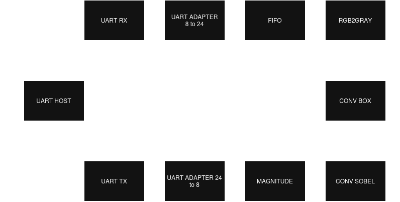
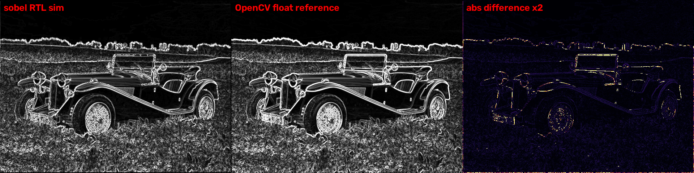
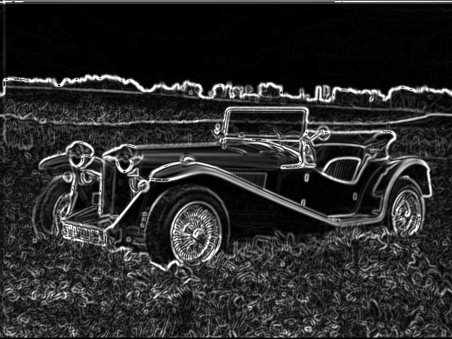
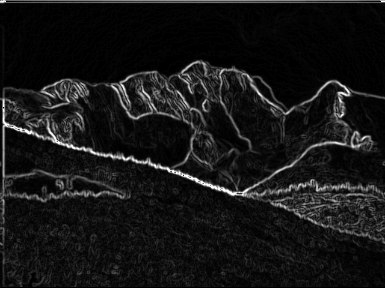

# SobelFilter

UART-streamed Sobel edge detection pipeline for iCE40 UP5K FPGA. Image data is transmitted over serial, processed on the FPGA, and streamed back as edge-detected output.

## Processing Pipeline



## Project Specifications

Target Device: Lattice iCE40 UP5K

Logic Cells: 1247 out of 5280 used (23%)

Block RAM: 13 out of 30 blocks used (43%)

Maximum Frequency: 39.05 to 43.32 MHz across 5 placement seeds (30 MHz core clock)

Clock Source: 12 MHz external oscillator via PLL

Numbers are for the full board top `syn/icebreaker/icebreaker.sv` with PLL, UART, and FIFO, from Yosys `synth_ice40` and nextpnr-ice40 with `syn/icebreaker/icebreaker.pcf`. The accelerator alone (`rtl/sobel`) uses 888 logic cells and 12 block RAMs and runs at 41.86 to 43.25 MHz.

Adding a register stage between the Sobel sum and the magnitude add raised the accelerator from 35.74 MHz to over 41 MHz. Before that change the critical path ran from the Sobel pipeline register through both gradient adds, the absolute value, and the saturating magnitude add, three carry chains in one cycle.

## Design Features

Elastic pipelining in convolution and magnitude stages for timing optimization

Elastic register between the Sobel gradients and the magnitude stage to split the adder chain

First word fall through synchronous FIFO for input buffering

Circular line buffer in block RAM for the 3x3 window, one 1R1W RAM per read tap

Gaussian matrix blur for noise reduction

Valid/ready handshake for rate-decoupled data flow

## Verification

The convolution modules (`conv2d`, `conv2d_box`) use cocotb Python testbenches. Every other module has a standalone SystemVerilog testbench (`<module>_test.sv`) in its own directory, with constrained random stimulus, a reference model and scoreboard, SystemVerilog assertions, and functional coverage. Run one with `make test SIM=vcs`, `SIM=xrun`, or `SIM=questa`.

### Full image test

`rtl/sobel/sobel_test.py` streams a full 640x480 image through `sobel` in cocotb with 10% random output stalls, and checks every output pixel against a bit-exact Python model of the RTL arithmetic.

```
cd rtl/sobel
make IMAGE=car        # car, comic, or mountain
```

Result on `car.jpg`: 0 mismatches against the bit-exact model over 304,636 pixels, after the 2,564 pixels the two line buffers need to fill.

Against an independent floating point OpenCV reference (`cvtColor`, `GaussianBlur`, `Sobel`, |gx| + |gy| clipped to 255), with the RTL output shifted by 2 rows and 2 columns to center the window:

| Metric | Value |
|---|---|
| Mean absolute difference | 5.3 grey levels |
| Pixels within 8 levels | 88.2% |
| Pixels exactly equal | 19.0% |



The difference comes from three approximations in the RTL. The grayscale shift and add weights sum to 0.9375 instead of 1.0, the blur truncates instead of rounding, and |gx| and |gy| keep only their low 8 bits before the saturating add. That last one wraps on the 1.5% of pixels where a gradient exceeds 255, which shows up as the bright spots on the strongest edges.

## Critical Path Analysis

The critical path now runs from the valid register of the Sobel pipeline stage, back through the ready signals of the elastic stages, into the address counter enables of the first line buffer. One accept signal fans out to three address counters, both RAM read enables, and the window registers, so about two thirds of the 23 ns path is routing.

## Example Outputs






